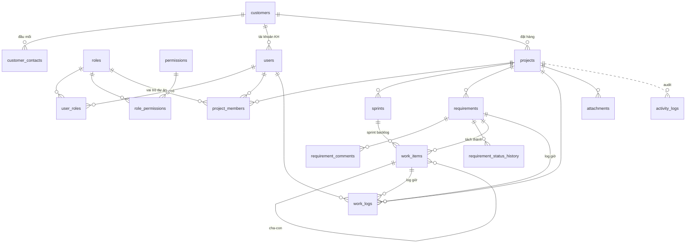

# Thiết kế Database – Quản lý dự án phần mềm (Scrum/Agile)

PostgreSQL 16 · Migration: Alembic (`backend/migrations/`) · Schema gốc: `backend/migrations/sql/0001_init_schema.sql`

## 1. Sơ đồ quan hệ (ERD)



## 2. Danh sách bảng

| Nhóm | Bảng | Mục đích |
|---|---|---|
| Người dùng & chức năng | `users` | Tài khoản (nội bộ + khách hàng qua `customer_id`), trạng thái, `is_system_admin` |
| | `permissions` | Danh mục chức năng dạng `module.action` (35 chức năng) |
| | `roles` | Vai trò, `scope` = `system` hoặc `project` |
| | `role_permissions` | Ma trận vai trò ↔ chức năng |
| | `user_roles` | Vai trò cấp hệ thống của user |
| | `project_members` | Thành viên + vai trò trong từng dự án (1 người nhiều vai trò được) |
| Khách hàng | `customers`, `customer_contacts` | Thông tin khách hàng, người liên hệ (tối đa 1 đầu mối chính) |
| Dự án | `projects` | `key` (ERP, CRM…) làm tiền tố mã, duy nhất giữa các dự án chưa xoá (xoá mềm xong dùng lại được; mã yêu cầu / công việc duy nhất trong dự án — revision 0003), PO, Scrum Master, độ dài sprint, ngân sách giờ |
| | `sprints` | Sprint goal, ngày, capacity, ghi chú Review/Retrospective |
| Yêu cầu KH | `requirements` | Mã tự sinh `ERP-REQ-0001`, loại, nguồn, ưu tiên, trạng thái, tiêu chí nghiệm thu, ngày mong muốn/cam kết, duyệt/từ chối |
| | `requirement_comments` | Trao đổi; `is_internal` để ẩn với khách hàng |
| | `requirement_status_history` | Lịch sử chuyển trạng thái (tự động) |
| Backlog | `work_items` | Epic/Story/Task/Bug/Subtask, mã `ERP-12`, story point, ước lượng giờ, `sprint_id NULL` = Product Backlog |
| Log | `work_logs` | **Log công việc**: ai, ngày nào, bao nhiêu giờ, làm gì, cho task/yêu cầu nào |
| | `activity_logs` | **Log hoạt động (audit)**: ai đổi gì, lúc nào, giá trị cũ/mới (JSONB), IP |
| Khác | `attachments` | File đính kèm cho yêu cầu / công việc / bình luận / sprint; ảnh lưu trên Cloudflare Images. Ảnh công việc có `category`: `bug` (ảnh lỗi) / `result` (ảnh sau khi sửa) — revision 0002. `entity_type = 'inline'`: ảnh dán trong ô văn bản (yêu cầu, bình luận, log công việc, sprint…), gắn với dự án, văn bản giữ dấu `[Ảnh: <tên file>]` — revision 0004 |

## 3. Luồng trạng thái yêu cầu khách hàng

```
new → analyzing → pending_approval → approved → in_progress → done → closed
                                  ↘ rejected (bắt buộc rejected_reason)
                    (bất kỳ) → cancelled
```

Trigger tự động: `approved` → set `approved_at/approved_by`; `done` → `resolved_at`; `closed/cancelled` → `closed_at`.

## 4. Vai trò mặc định

| Vai trò | Phạm vi | Quyền chính |
|---|---|---|
| SYSTEM_ADMIN | system | Toàn quyền |
| PROJECT_MANAGER | system | Tạo dự án, quản lý khách hàng, báo cáo |
| STAFF | system | Xem user, khách hàng |
| PRODUCT_OWNER | project | Toàn quyền yêu cầu, backlog, sprint, duyệt yêu cầu |
| SCRUM_MASTER | project | Sprint, thành viên, công việc, quản lý log |
| BA | project | Tạo/cập nhật/phân công yêu cầu |
| DEVELOPER / TESTER | project | Xem yêu cầu, cập nhật công việc, ghi log giờ |
| VIEWER | project | Chỉ xem |
| CUSTOMER | project | Gửi yêu cầu, bình luận, theo dõi |

Kiểm tra quyền: `SELECT fn_user_has_permission(:user_id, 'requirement.approve', :project_id);`

## 5. Quy ước cho ứng dụng

Trong mỗi transaction, ứng dụng đặt ngữ cảnh để trigger ghi log đúng người:

```sql
BEGIN;
SET LOCAL app.current_user_id = '12';
SET LOCAL app.client_ip       = '10.0.0.5';
SET LOCAL app.status_note     = 'KH xác nhận qua email';  -- ghi chú khi đổi trạng thái (tuỳ chọn)
UPDATE requirements SET status = 'approved' WHERE id = 5;
COMMIT;
```

- **Xoá mềm**: set `deleted_at` (users, customers, projects, requirements, work_items, comments). Log ghi action `soft_delete`.
- **Audit tự động** trên: users, customers, projects, project_members, sprints, requirements, requirement_comments, work_items, work_logs, attachments. Chỉ lưu các trường thay đổi, bỏ `password_hash`.
- Ứng dụng tự ghi thêm vào `activity_logs` các sự kiện không phải thay đổi dữ liệu: `login`, `logout`, `login_failed`, `export`…
- **Toàn vẹn chéo dự án**: FK kép `(project_id, sprint_id)`, `(project_id, requirement_id)`, `(project_id, work_item_id)` đảm bảo task/log không gắn nhầm sprint/yêu cầu của dự án khác.
- Mỗi dự án chỉ có **1 sprint `active`**; vai trò gán vào dự án bắt buộc có `scope = 'project'`.

## 6. View báo cáo

- `v_requirement_overview` – mỗi yêu cầu: số task, số task xong, tổng giờ đã log, quá hạn hay chưa.
- `v_sprint_progress` – story point kế hoạch/hoàn thành, giờ đã log theo sprint.
- `v_work_log_daily` – tổng giờ (và giờ tính phí) theo người/dự án/ngày.

## 7. Hướng mở rộng

- Partition `activity_logs` theo tháng khi dữ liệu lớn.
- Bảng `releases` (phiên bản phát hành), `notifications`, `labels` riêng thay cho `tags text[]`.
- Workflow trạng thái tuỳ biến theo dự án (bảng `workflow_statuses`) thay cho enum cố định.
- Bảng `sprint_snapshots` lưu số liệu hằng ngày để vẽ burndown chart.
